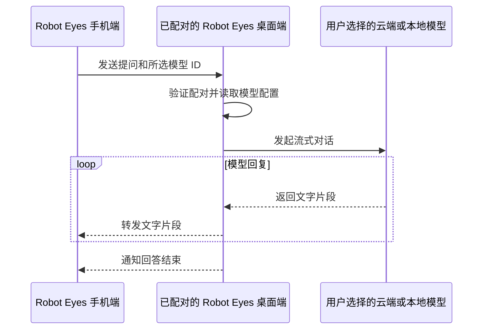

# Robot Eyes 手机联动与语音交互设计

## 产品目标

Robot Eyes 的眼睛会对手机事件和对话做出反应。重要提醒通过眼睛表情和大屏气泡显示。用户可以直接向机器人提问，由自己配置的 AI 回答，并选择是否朗读。

Android 和 iOS 共用表情、大屏、气泡、对话与模型选择。系统事件入口按平台分别实现。配对电脑负责执行用户选择的云端或本地模型调用。

## 双端共用体验

### 大屏和气泡

- 眼睛始终是大屏的主要内容。通知气泡短暂显示来源和摘要，点开可查看已取得的详情。对话气泡保留最近一问一答，长回复可展开。
- 眼睛跟随当前交互切换为聆听、思考、回答或提醒。短暂提醒结束后，恢复之前的对话表情、AI 工具状态或待机表情。
- 提醒在语音对话期间安静显示，播报排在当前回答之后。开启播报时，普通消息会读出发送人、App 与内容，长短信只读开头，验证码逐字符播报。系统隐藏验证码时只播报收到验证消息。提醒自然消失后仍可从最近提醒中查看。

### 主屏触摸表情

| 当前状态 | 单击 | 双击 | 滑动 |
| --- | --- | --- | --- |
| 休眠 | 靠近触点的一只眼偷瞄片刻，再闭上。 | 双眼睁大，稍稍弹起，落回清醒时的表情。 | 朝手势方向翻身，重新合眼。 |
| 待机、跟随 | 轮换眨眼、眼睛睁大和轻眯，先回应被点到的一侧。 | 双眼笑成弯月，轻跳两拍。 | 眼睛跟手，松开时沿滑动方向轻轻摆回。 |
| 已完成、招呼、灵感 | 用睁眼或弯眼回应。 | 用更明显的笑眼或招呼庆祝。 | 保留当前表情，轻摆后归位。 |
| 思考、等确认、出错、听说中 | 单侧轻眯或轻点头，保留状态表情。 | 双眼轻眯并点两下头，聆听和朗读持续。 | 小幅跟手，松开后回到当前状态。 |

按下即看向触点。休眠时靠近手指的眼皮先抬起，拖动中随手势翻身。松手后接入手势对应的表情，单击表情在双击判定窗口结束后播放。全屏双击只触发一次动画，同时切换原有控件。首页可纵向滚动的眼睛预览用横向滑动触发表情。

### 语音与文字对话

1. 用户点麦克风开始说话，眼睛进入聆听状态，气泡显示识别中的文字。用户可以停止、取消录音，或修改转写后再发送。文字输入走同一套对话流程。
2. 手机发送请求后，眼睛进入思考状态，气泡显示当前模型。收到流式回复后，气泡逐步显示文字，眼睛进入回答状态。
3. 开启朗读时，按完整句子播报，气泡标记正在朗读的句子。点气泡里的喇叭可以立即停止当前播报，文字继续接收。再次点麦克风会打断当前对话输出，开始下一轮聆听。
4. 连接失败时保留用户的提问，气泡提供重试和切换模型。用户取消时停止接收后续内容，并结束当前播报。

| 设置 | 默认值 | 行为 |
| --- | --- | --- |
| 朗读 AI 回复 | 开启 | AI 回答通过语音朗读。关闭后仍显示完整文字和表情。 |
| 播报重要提醒 | 关闭 | 开启后只播报用户选中的提醒摘要。 |
| 气泡静音 | 由用户触发 | 立即停止本次播报，保留气泡和回复内容。 |

## Android 专属能力

- **重要通知**。用户在系统设置授权通知访问后，Robot Eyes 可以读取当前活动通知并监听后续通知事件。用户选择关注的 App，再基于可用的发送者信息或关键词筛选。命中后显示提醒表情、来源和摘要。撤销权限后停止读取。 [Android 通知监听服务](https://developer.android.com/reference/android/service/notification/NotificationListenerService)
- **验证消息**。识别到验证类通知时显示「收到验证消息」。用户主动打开详情时，只展示系统提供的可用内容。Android 15 起，系统检测到的验证码内容可能被遮盖。体验以收到提示为准，完整验证码只在系统允许时可用。 [Android 15 通知隐私限制](https://developer.android.com/about/versions/15/behavior-changes-all#otp-redaction)

## iOS 专属能力

- **快捷指令**。提供「显示提醒」「切换表情」动作，供用户关联消息、邮件或其他适用的个人自动化。例如指定联系人发来消息时显示「家人发来消息」。可以先使用固定提示语。快捷指令实际能传入的字段、锁屏执行和横屏显示时机需在实机验证。 [Apple 通信触发条件](https://support.apple.com/guide/shortcuts/communication-triggers-apdd711f9dff/ios) · [个人自动化设置](https://support.apple.com/guide/shortcuts/enable-or-disable-a-personal-automation-apd602971e63/ios)
- **分享给 Robot Eyes**。从系统分享菜单接收用户主动选中的内容，由用户选择显示或向 AI 提问。
- **实况活动**。在支持的设备上展示 Robot Eyes 自己的进行中任务状态，例如「AI 正在处理」和「等待确认」。普通 iOS App 的通知 API 只提供本 App 的通知，其他 App 的通知由用户设置的快捷指令或主动分享触发。 [Apple 通知接口](https://developer.apple.com/documentation/usernotifications/unusernotificationcenter/getdeliverednotifications%28completionhandler%3A%29) · [Apple 实况活动](https://developer.apple.com/documentation/activitykit/displaying-live-data-with-live-activities)

## 桌面端模型连接

手机以已配对的 Robot Eyes 桌面端为入口。桌面端选择并调用模型，手机接收流式回答、渲染气泡和控制朗读。

### 桌面端设置

- 在「模型连接」保存多个模型配置。每项包含显示名称、服务地址、模型名称或 ID，以及服务要求的密钥。一个配置可以指向云端 API，也可以指向电脑本机运行的模型服务。
- 提供「测试连接」，分辨桌面无法访问模型服务、密钥无效和模型不可用等结果。电脑代理调用时，手机获取可用模型的名称、ID 和状态。需要手机直接调用云端时，可在「手机模型」中选择模型，地址、模型 ID 和密钥会通过已配对的 HTTPS 连接同步到指定手机。桌面回显手机确认的来源和模型，手机端保存云端修改后同步回电脑。
- 调用模型时根据已保存的模型 ID 选取连接。取消请求需要停止桌面端的上游生成，手机同时停止字幕更新与朗读。

### 手机连接

- 沿用现有桌面配对身份。设计上同一局域网优先使用已配对的局域网连接，异地可经 Tailscale 访问桌面端。模型入口需要独立的请求路径和配对鉴权。
- 现有「手机局域网」用于桌面向手机同步状态。模型请求从手机发往桌面，两项功能分别显示连接状态。
- 手机在气泡旁显示所选模型，例如「电脑 · 本地模型」。切换连接路径时仍使用同一个模型配置。模型或电脑离线时，只有用户主动选择才切换至云端模型。
- 通知内容默认保留在提醒交互里。用户点「问 AI」后，才把选中的内容加入该次请求。

## 验收场景

| 场景 | 预期结果 |
| --- | --- |
| Android 收到关注 App 的普通重要通知 | 显示来源和摘要，眼睛短暂提醒，之后恢复原状态。 |
| Android 收到验证码类通知 | 显示验证提醒。系统遮盖完整验证码时仍可完成提醒。 |
| iOS 收到用户设置的指定消息或邮件 | 快捷指令触发指定表情和提示语，并验证锁屏与前台表现。 |
| iOS 分享一段内容 | 内容出现在 Robot Eyes，用户选择后才发给模型。 |
| Android 和 iOS 通过局域网询问电脑本地模型 | 回复逐步显示，朗读可即时关闭，取消后停止本轮输出。 |
| Android 和 iOS 通过配对电脑选择云端模型 | 电脑调用选中的服务，手机显示模型名称和回答，手机端无需保存该服务密钥。 |
| 电脑离线、模型不可用或用户拒绝通知访问 | 保留可用的交互。失效的功能给出对应反馈，模型选择由用户决定。 |
